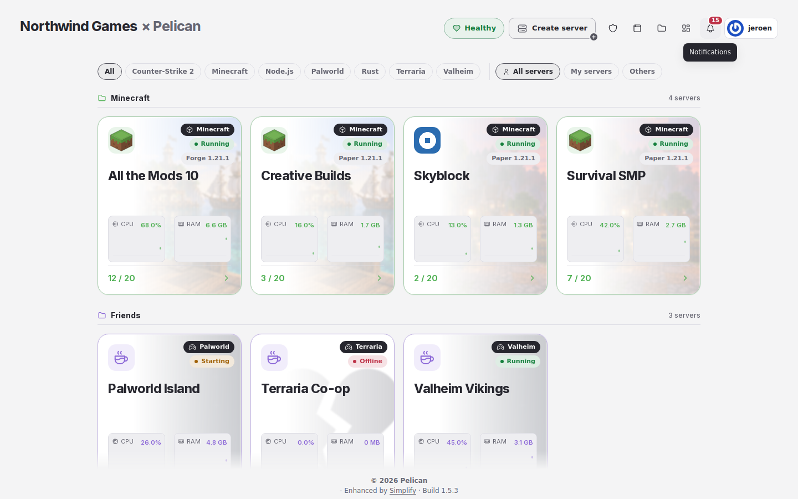
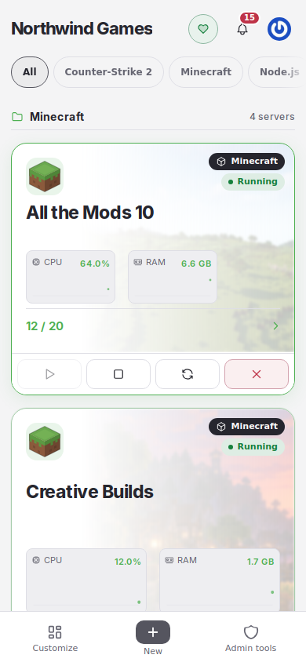

# Simplify

A [Pelican](https://pelican.dev) plugin that gives you one clear overview of your servers, with announcements,
subdomains and your servers on your own website. Add-ons such as Server Maker are separate plugins that show
up inside Simplify when both are installed.

Simplify 1.0 is a rebuild from the ground up. The earlier PelicanSimplify (0.6.0 and before) lives in
[PelicanSimplify](https://github.com/jerajerajerajera/PelicanSimplify).

## What it does

- An overview of all your servers as cards, compact rows or a list, with live numbers, players, filters, a section
  per node and your own groups. Start, stop and restart from each card. A server without a picture of its own shows an
  icon for its kind of server.
- A server page that fits the window: a header card with status, address and power, number cards, a short menu and
  the live console. While a server installs, a card shows the steps and how long it usually takes; after that, First
  start asks for the Minecraft EULA when it is still open. The menu changes only the page next to it.
- Create server opens in a Simplify popup from every entry point, with Server Maker when it is installed.
- Host mode for admins: the admin pages and the servers per node on the left, the page on the right, node health at
  the bottom. Pelican's admin pages open inside Simplify.
- Announcements at the top of every page, in the bell, as app notifications and in game chats.
- Your servers on your own website, with a script, an iframe or a status page.
- A subdomain for every server under your own domain, made in Cloudflare and removed with the server.
- Your own name, logo, colours and app icon. Install the panel as an app with notifications per device; every
  notification option sits in the bell's window.
- On a phone one frame with a bar at the bottom, menus that open as a sheet from the bottom, settings that save
  themselves, and pull down to reload in the installed app.
- A setup that checks the panel, asks who it is for and sets up the installed add-ons in one go.
- 32 languages.

<picture>
  <source media="(prefers-color-scheme: dark)" srcset="docs/screenshots/overview-egg-icons-dark-desktop.png">
  
</picture>
<picture>
  <source media="(prefers-color-scheme: dark)" srcset="docs/screenshots/phone-overview-dark-phone.png">
  
</picture>

## Install

Install Simplify from the [Pelican Hub](https://hub.pelican.dev). Updates come from the Hub only.

## Add-ons

See [ADDONS.md](ADDONS.md) for how an add-on plugs into Simplify.

## What it sends where

Simplify talks to your own panel and your Wings nodes, and to nothing else, with one exception people choose for themselves:

- **App notifications.** When someone turns them on for a device, the panel sends their notifications to the push service of that browser: Google (`fcm.googleapis.com`), Mozilla (`push.services.mozilla.com`), Apple (`push.apple.com`) or Microsoft (`notify.windows.com`). The content is encrypted for that device only. Root admins can turn app notifications off for the whole panel in Simplify's settings.
- **Subdomains** (when a root admin sets them up): Cloudflare's API (`api.cloudflare.com`), with the token the admin pasted, to make and remove the DNS records of each server's subdomain. A sync runs every five minutes through Pelican's scheduler (`simplify:subdomains`).
- Update notices for root admins use Pelican's own version check and Pelican's cached node information; Simplify makes no extra calls for them. They run hourly through Pelican's scheduler (`simplify:update-notices`).

Open routes (no login): `/simplify/assets/{name}` serves Simplify's stylesheet and logo, and `/simplify/brand/{file}` serves the panel logo and app icon an admin uploaded in Simplify's settings. `/simplify/banners/{file}` serves server banners, only to people who are signed in. `/simplify/manifest.webmanifest`, `/simplify/app-icon-192.png`, `/simplify/app-icon-512.png` and `/simplify-worker.js` let a browser install the panel as an app; the worker caches only a small offline page. `/simplify/embed`, `/simplify/embed.js` and `/simplify/embed/servers.json` show the servers an owner or root admin put on a website: name, game, status, players and the public join address, nothing else.

Announcements are delivered every minute through Pelican's scheduler (`simplify:announcements`), to the bell, as app notifications and in game chats.

## Development

- `bash tests/run.sh` runs the checks that need no panel, including `tests/hub-check.py`.
- `pint` formats the code (Laravel preset).
- `python3 scripts/build-package.py` builds the zip for the Hub.

## License

Source available, see [LICENSE.md](LICENSE.md). Copyright (c) 2026 Jeroen (jerajerajerajera).
